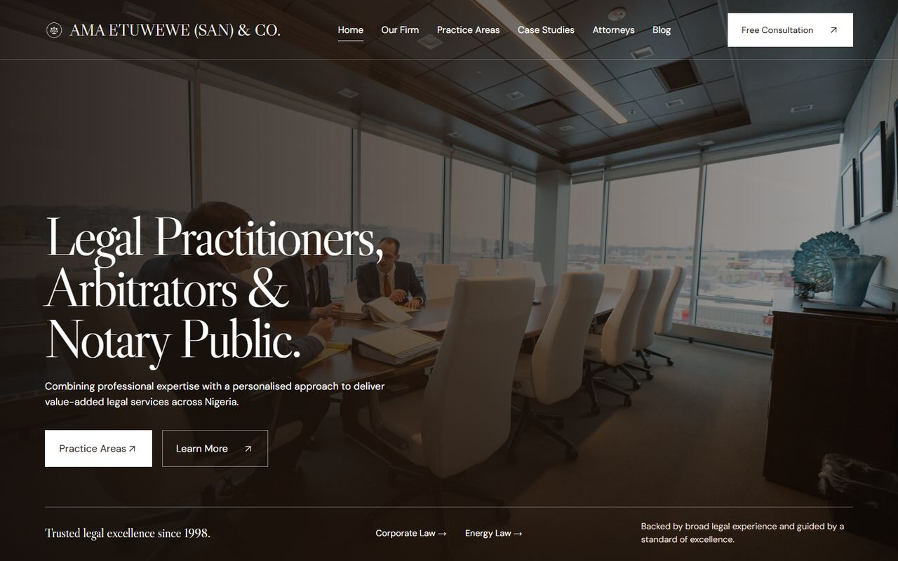

# AMA Etuwewe (SAN) & Co. website

Website for a Nigerian law firm, presenting its practice areas, attorneys, clientele and contact details.

**Live:** [ama-etuwewe-san-co.vercel.app](https://ama-etuwewe-san-co.vercel.app)



## What's included

- Home, about, practice areas, clientele and briefs, attorneys, insights and contact pages
- Detail pages for practice areas
- Office location map on the contact page
- Shared spacing system and responsive layouts

## Stack

React, Vite, Framer Motion, Lucide icons, deployed on Vercel. Routing is a small path-based switch in `src/main.jsx`, and `vercel.json` rewrites all paths to the single page.

## Running locally

```sh
npm ci
npm run dev
npm run build
```

No environment variables are needed. The project has no automated tests yet.

## Next

- Split `src/main.jsx` into page components
- Set page titles and descriptions per route for search engines
